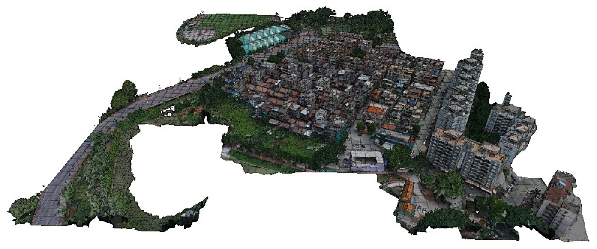
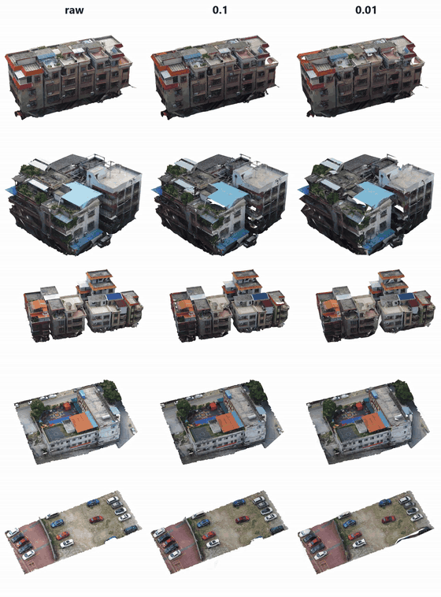
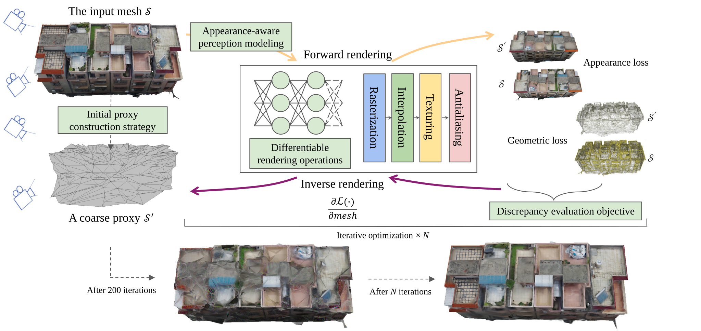

<p class="hero" align="center"></p>

<h1 align="center">Mosalite:Differentiable Mesh Simplification</h1>

<p align="center"><b>几何与外观联合驱动的可微分模型简化</b></p>

<p align="center"><a href="#comparison">Example</a> · <a href="#method">Method</a> · <a href="#installation">Installation</a> · <a href="#train">Train</a></p>

<a id="comparison"></a>

## Example

[](assets/videos/comparison-matrix.mp4)

<a id="method"></a>

## Method

方法以原始模型为参照，先构建初始代理，再通过可微分方法联合利用几何与外观信息进行迭代优化。



<a id="install"></a>
<a id="installation"></a>

## Installation

[Windows 原生安装](#installation-windows) · [Linux / WSL2 安装](#installation-linux) · [环境验证](#installation-check)

### Requirements

两套流程共用 [environment.yml](environment.yml)，以下版本依据所提供的环境记录整理。此文件包含 Python 与算法依赖；CUDA Toolkit 和 C++ 编译器需按操作系统另外安装。

| 组件                                 | 参考配置                                                   |
|:---------------------------------- |:------------------------------------------------------ |
| 系统                                 | Windows 10/11 x64，或 Linux x86_64                       |
| GPU                                | 支持 CUDA 的 NVIDIA GPU，且 `nvidia-smi` 可正常运行              |
| Python                             | 3.9.25                                                 |
| PyTorch / torchvision / torchaudio | 2.0.1 / 0.15.2 / 2.0.2                                 |
| CUDA runtime / Toolkit             | 11.7 / 11.7，Toolkit 需包含 `nvcc`                         |
| nvdiffrast / PyTorch3D             | 0.4.0 / 0.7.4，按固定版本源码编译                                |
| Open3D / NumPy                     | 0.19.0 / 1.23.5                                        |
| Windows 编译器                        | MSVC x64；下文以 Visual Studio Build Tools 2019、v142 工具集为例 |
| Linux 编译器                          | 兼容 CUDA 11.7 的 GCC/G++；下文以 GCC/G++ 11 为例               |

`environment2.yml` 是原始 Linux 环境快照，含 Linux 专用包与混合版本 CUDA 工具链。新安装统一使用精简后的 `environment.yml`，不将该快照直接用于原生 Windows。

**版本说明：** 以上为导出环境的参考组合，尚未在两平台完整复现。nvdiffrast [当前官方文档](https://nvlabs.github.io/nvdiffrast/)推荐较新的 PyTorch（2.7+）；这里保留导出记录中的版本，固定标签的构建兼容性需实际验证。请勿直接改装最新主分支，或只升级 PyTorch 而不同时核对 PyTorch3D 等扩展的版本。

<a id="installation-windows"></a>

### Windows

#### 1. 安装系统工具

安装以下组件：

- Miniconda / Anaconda 的 Windows x64 版本，以及 Git for Windows。
- Visual Studio Build Tools 2019，选择 **Desktop development with C++**，包含 **MSVC v142 x64/x86** 和 Windows SDK。
- NVIDIA 显卡驱动与 **CUDA Toolkit 11.7**，参考 [CUDA 11.7 Windows 安装指南](https://docs.nvidia.com/cuda/archive/11.7.0/cuda-installation-guide-microsoft-windows/index.html)。

CUDA 11.7 对 MSVC 有版本要求。若使用 Visual Studio 2022，应选择官方支持列表内的工具集，不直接使用最新编译器替代。该配置下，使用 VS 2019 的 x64 编译环境更贴近 [PyTorch3D 0.7.4 的 Windows 构建说明](https://github.com/facebookresearch/pytorch3d/blob/v0.7.4/INSTALL.md)。

#### 2. 创建环境并编译扩展

在同一个终端中执行：

```bat
conda env create -f environment.yml
conda activate name

python --version
python -c "import torch; print('PyTorch:', torch.__version__); print('CUDA runtime:', torch.version.cuda); assert torch.cuda.is_available(), 'CUDA is unavailable'"

python -m pip install --no-build-isolation "git+https://github.com/NVlabs/nvdiffrast.git@v0.4.0"
python -m pip install --no-build-isolation "git+https://github.com/facebookresearch/pytorch3d.git@v0.7.4"
```

参考输出为 Python 3.9.x、PyTorch 2.0.1、CUDA runtime 11.7。扩展构建可能需要一段时间；PyTorch3D 的原生 Windows 编译可能遇到版本相关的头文件问题，需依据具体错误与上述官方版本文档处理。

每次打开新终端，需要重新激活 Conda 环境；继续编译扩展时，还需重新加载 MSVC 环境及上面的会话变量。

<a id="installation-linux"></a>

### Linux / WSL2

#### 1. 创建环境并配置工具链

进入包含 `environment.yml` 的项目目录。CUDA 路径按实际安装位置调整：

```bash
conda env create -f environment.yml
conda activate name

export CUDA_HOME=/usr/local/cuda-11.7
export PATH="$CUDA_HOME/bin:$PATH"
export CC=gcc-11
export CXX=g++-11
export MAX_JOBS=4

nvcc --version
python --version
python -c "import torch; print('PyTorch:', torch.__version__); print('CUDA runtime:', torch.version.cuda); assert torch.cuda.is_available(), 'CUDA is unavailable'"
```

#### 3. 编译扩展

```bash
python -m pip install --no-build-isolation "git+https://github.com/NVlabs/nvdiffrast.git@v0.4.0"
python -m pip install --no-build-isolation "git+https://github.com/facebookresearch/pytorch3d.git@v0.7.4"
```

两平台均先安装 PyTorch，再构建扩展。`--no-build-isolation` 让编译过程使用当前环境的 PyTorch。每次打开新终端时重新激活环境；重新编译前还需设置对应的工具链变量。

<a id="installation-check"></a>

### Verify the installation

Windows 和 Linux 均在项目目录、已激活的 `nvdiffmodeling` 环境中运行：

```text
python -m pip check
python scripts/check_environment.py
```

检查脚本会输出 Python、PyTorch、CUDA 和网格库版本，并实际调用 PyTorch3D 的 GPU 最近邻算子及 nvdiffrast 的三角形光栅化。看到 `Environment check passed.` 后，再按下方使用指导准备模型与优化配置。

</details>

<a id="usage"></a>
<a id="train"></a>

## Train

### 1. 训练命令

激活环境后，在包含 `train_mesh_simply.py` 的项目根目录运行：

```bash
python train_mesh_simply.py --config ./data.yaml
```

参考配置中的 `base_mesh` 使用模型基础路径，原文件未带扩展名；请按训练程序的数据加载约定填写。本目录提供的是配置与 README 示例，训练脚本需放在实际算法项目中运行。

### 2. 关键参数

下面列出常用的配置项。

| 参数                                        | 示例值                    | 说明                                      |
|:----------------------------------------- |:---------------------- |:--------------------------------------- |
| `base_mesh`                               | `./dataset/raw/123`    | 原始模型的基础路径，运行前替换为本地数据路径。                 |
| `out_dir`                                 | `test`                 | 训练结果的输出目录。                              |
| `sample_type`                             | `unclosed`             | 采样类型标记；参考配置提供 `closed`、`unclosed` 两种选项。 |
| `percent_rate`                            | `0.05`                 | 简化比例参数。具体比例口径以训练实现为准。                   |
| `simplification_rate`                     | `0.7`                  | LOD 阶段的简化控制参数。最终面数保留比例以输出统计为准。          |
| `batch`                                   | `8`                    | 每次迭代的批量大小。                              |
| `num_iter`                                | `10000`                | 训练迭代次数。                                 |
| `learning_rate`                           | `0.010`                | 优化学习率。                                  |
| `train_res`                               | `[1024, 1024]`         | 训练渲染分辨率，影响图像细节与计算开销。                    |
| `texture_res`                             | `[16384, 16384]`       | 纹理分辨率，影响外观表示与显存开销。                      |
| `lamda_img` / `lamda_ssim`                | `0.7` / `0.3`          | 图像误差与结构相似性损失的权重。                        |
| `lamda_geom`                              | `1`                    | 几何损失权重。                                 |
| `lamda_lap` / `lamda_edge` / `lamda_move` | `1.0` / `0.35` / `0.1` | 拉普拉斯、边与位移相关约束的权重。                       |

### 3. 数据集索引

数据尚未发布到 GitHub，下载入口、来源与授权信息待发布时补充。
